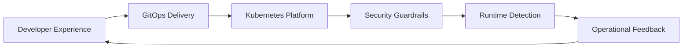

# Praveen Bhat

### Senior Platform Engineer | DevSecOps | Kubernetes | GitOps | Cloud Infrastructure

I build secure, production-grade cloud platforms that make delivery faster, operations calmer, and security easier to prove.

  
  
  

---

## What I Do

I am a Senior Platform and DevSecOps Engineer with 17+ years of experience across cloud infrastructure, Kubernetes platforms, GitOps delivery, automation, and security engineering.

My strongest work sits at the intersection of:

- Kubernetes platform engineering across EKS, GKE, AKS, and OpenShift
- Terraform-based infrastructure platforms with reusable modules and CI validation
- GitOps operating models with Argo CD, Helm, policy controls, and drift detection
- DevSecOps guardrails with Kyverno, OPA Gatekeeper, Trivy, Kubescape, Falco, and kube-bench
- Multi-tenant Kubernetes with vCluster, from virtual control planes to bare metal auto-nodes
- Internal developer platforms with Backstage golden paths, Vault, and External Secrets
- Incident response, reliability engineering, observability, and operational automation

## Recent Projects

| Project | What It Demonstrates | Stack |
| --- | --- | --- |
| vcluster-multi-tenant-demo | Two tenants define the same CRD name with incompatible schemas on one host cluster. Runnable proofs of tenant-to-tenant isolation, plus a written trust model for the host operator boundary | vCluster, kind, CRDs, RBAC |
| [vcluster-bare-metal-with-kubevirt](https://github.com/praveenbhatk8s/vcluster-bare-metal-with-kubevirt) | vCluster auto-nodes on simulated bare metal: KubeVirt VMs behind a Redfish BMC, provisioned by Metal3/Ironic and joined to a tenant vCluster. Run on AWS EC2; debugged a Karpenter panic in the syncer (fork of loft-sh's demo) | vCluster Platform, Metal3, Ironic, KubeVirt, Multus, kube-vip |
| [argo-rollouts-lab](https://github.com/praveenbhatk8s/argo-rollouts-lab) | Step-by-step progressive delivery lab with recorded observations, including KEDA autoscaling an Argo Rollout from 2 to 10 replicas under load | Argo Rollouts, Argo CD, KEDA |
| [observability-lab](https://github.com/praveenbhatk8s/observability-lab) | Grafana LGTM stack on Kubernetes via GitOps, built toward metrics, logs, traces, and profiles linked per request | Grafana, Mimir, Loki, Tempo, Pyroscope, Alloy, OpenTelemetry |
| [homelab](https://github.com/praveenbhatk8s/homelab) | GitOps-managed Backstage IDP with a golden path template: new service repo, PR with Argo CD app, image updates, and catalog registration | Backstage, Argo CD, Image Updater, Vault, ESO, k3d |
| [utility-delivery-labs](https://github.com/praveenbhatk8s/utility-delivery-labs) | Customer delivery for a fictional smart-metering utility, from approved architecture to hardened platform, DR drills, and handover | Terraform, Azure, Kubernetes, Go, Argo CD |
| [k8s-troubleshooting-lab](https://github.com/praveenbhatk8s/k8s-troubleshooting-lab) | Break-and-fix Kubernetes failure scenarios with verify scripts, hints, and solutions | Kubernetes, Bash, crictl |

## Portfolio Highlights

| Project | What It Demonstrates | Stack |
| --- | --- | --- |
| [mlops-autofix-poc](https://github.com/praveenbhatk8s/mlops-autofix-poc) | Self-healing MLOps deployment pattern where Argo Rollouts blocks a faulty canary and keeps stable traffic healthy | Kubernetes, kind, FastAPI, Argo Rollouts |
| [terraform-eks-platform](https://github.com/praveenbhatk8s/terraform-eks-platform) | Production-style EKS foundation with VPC, node groups, Karpenter, add-ons, and Terraform CI | Terraform, AWS, EKS, Karpenter, GitHub Actions |
| [argocd-gitops-platform](https://github.com/praveenbhatk8s/argocd-gitops-platform) | App-of-apps GitOps delivery platform with Helm workloads and automated reconciliation | Argo CD, Helm, Kubernetes, GitOps |
| [kubernetes-security-hardening](https://github.com/praveenbhatk8s/kubernetes-security-hardening) | Kubernetes security lab covering admission control, runtime detection, scanning, and hardening tests | Kyverno, Gatekeeper, Falco, Trivy, Kubescape |
| [agentic-sre-platform](https://github.com/praveenbhatk8s/agentic-sre-platform) | Agentic incident triage workflow with guardrails and Kubernetes remediation hooks | Python, FastAPI, Kubernetes, SRE automation |
| [devops-cicd-demo](https://github.com/praveenbhatk8s/devops-cicd-demo) | CI/CD platform demo with Jenkins, Kubernetes, Helm, Kaniko, quality gates, registry, and observability tooling | Jenkins, Kubernetes, Helm, Kaniko, SonarQube, Trivy |
| [devsecops-cicd-k8s-pipeline](https://github.com/praveenbhatk8s/devsecops-cicd-k8s-pipeline) | Spring Boot DevSecOps pipeline with Kubernetes deployment and monitoring | Jenkins, SonarQube, Nexus, Trivy, Prometheus |
| [End-to-End-Kubernetes-Three-Tier-DevSecOps-Project](https://github.com/praveenbhatk8s/End-to-End-Kubernetes-Three-Tier-DevSecOps-Project) | Three-tier app on AWS EKS with Terraform, Jenkins, Argo CD, Helm, and monitoring | AWS EKS, Terraform, Jenkins, Argo CD |

## Recently Learned: Multi-Tenancy with vCluster

From building the vCluster demos above:

- **Virtual control planes**: a dedicated API server and CRD registry per tenant, with tenant workloads synced to the host as plain pods
- **Isolation testing**: proving tenant-to-tenant isolation with runnable checks (same-name CRDs, cross-tenant schema rejection, `kubectl auth can-i`)
- **Trust model**: where shared-host isolation stops (host admins can read tenant kubeconfig Secrets) and what each mitigation actually buys: RBAC, audit logs, etcd encryption, dedicated nodes, confidential computing
- **Tenancy tiers**: shared/virtual nodes for lightweight tenants, private auto-nodes for tenants that need dedicated hardware
- **Bare metal provisioning**: Metal3 and Ironic driving BareMetalHosts over Redfish, OS images, cloud-init, NodeProviders, NodeClaims, and NodeTypes
- **Lab infrastructure**: KubeVirt VMs as fake bare metal, Linux bridge networking, Multus, DHCP, and kube-vip, hosted on AWS EC2
- **Debugging**: reading vCluster syncer logs to trace a Karpenter nil-map panic during node join

## Technical Depth

**Cloud and Platform**

**Infrastructure and Delivery**

**Security and Reliability**

## Architecture Mindset

The goal is not just infrastructure that works. The goal is infrastructure that teams can understand, operate, secure, and improve.

## Certifications

- Certified Kubernetes Security Specialist
- Certified Kubernetes Administrator
- Certified Kubernetes Application Developer
- Red Hat Certified System Administrator
- Red Hat OpenShift Administration
- ITIL V3 Certified
- CCNA equivalent certification from HughesNet
- LPIC 1 & 2 Certified

## Current Focus

- Platform engineering roles at Senior, Lead, Staff, or Principal level
- Kubernetes and GitOps platform ownership
- Multi-tenant platforms with vCluster, including bare metal and GPU-style tenancy models
- Full-stack observability with the Grafana LGTM stack and OpenTelemetry
- DevSecOps transformation and cloud security hardening
- Progressive delivery, MLOps reliability patterns, and self-healing deployment workflows
- Internal developer platforms and operational automation

## Contact

- LinkedIn: [linkedin.com/in/praveen-bhat-99923111](https://www.linkedin.com/in/praveen-bhat-99923111)
- Email: [prav.bh@gmail.com](mailto:prav.bh@gmail.com)
- Location: Germany

---

> Build platforms developers love, security teams trust, and businesses can scale on.
